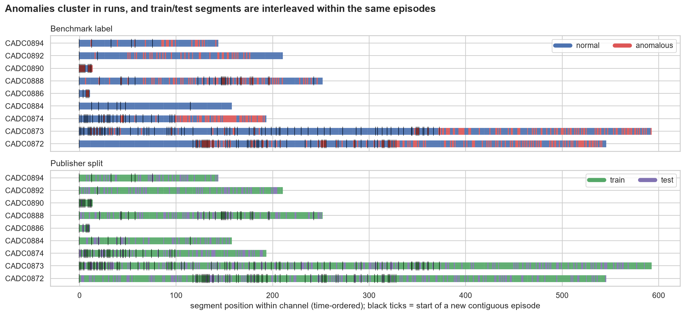
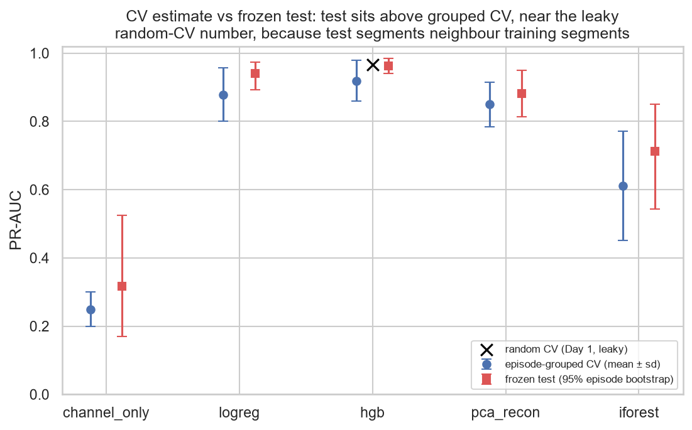

# SatelliteGuard

**Machine learning-based anomaly detection in satellite telemetry for early fault identification.**

SatelliteGuard is a reproducible, leakage-safe benchmark and decision-support dashboard built on
the ESA OPS-SAT telemetry dataset (OPSSAT-AD). It ranks telemetry segments for operator review.

> **Scope:** the system flags *anomalous segments* for review. It does **not** diagnose or
> confirm spacecraft hardware faults. Labels are segment-level benchmark annotations, and channel
> IDs (e.g. `CADC0872`) are opaque — no subsystem meaning is claimed.

**Technical report:** [reports/technical_report.pdf](reports/technical_report.pdf)
([Markdown version](reports/technical_report.md)) · **Model card:** [docs/model_card.md](docs/model_card.md)
· **Decision log:** [docs/decision_log.md](docs/decision_log.md)

## Quick start

```bash
python -m venv .venv
# Windows: .venv\Scripts\activate    macOS/Linux: source .venv/bin/activate
pip install -r requirements-lock.txt   # exact versions behind the committed results
pip install -e .
python scripts/reproduce.py            # full pipeline + diff of every number vs the commit
```

Step by step:

```bash

python -m satelliteguard.data.download   # fetch + checksum-verify Zenodo files
python -m satelliteguard.data.validate   # data-contract audit (red gate)
python -m satelliteguard.data.episodes   # segment index + contiguous episodes
python -m satelliteguard.models.tune logreg   # bounded hyperparameter grids
python -m satelliteguard.models.tune hgb
python -m satelliteguard.models.tune pca_recon
python -m satelliteguard.models.tune iforest
python -m satelliteguard.models.train    # grouped CV, thresholds, final models
python -m satelliteguard.evaluation.compare hgb logreg
python -m satelliteguard.evaluation.compare hgb pca_recon
python -m satelliteguard.models.explain  # held-out SHAP
python -m satelliteguard.evaluation.evaluate_test   # frozen test, refuses to run twice
python -m satelliteguard.evaluation.plots
python -m satelliteguard.dashboard.extract  # small committed extracts for the dashboard
pytest -q

streamlit run app/streamlit_app.py          # dashboard (needs only committed files)
python scripts/capture_dashboard.py         # dashboard screenshots for the report (Chrome/Edge)
python -m satelliteguard.report             # report: numbers filled from reports/*.json -> PDF
```

`requirements.txt` lists minimum versions; `requirements-lock.txt` pins the exact environment
(Python 3.13) that produced the committed results.

## Dashboard

`streamlit run app/streamlit_app.py` opens a five-page decision-support dashboard. It reads only
committed files (`data/processed/dashboard/`, `reports/*.json`), never fits a model and does not
need the raw download, so it also runs on Streamlit Community Cloud.

| Page | What it shows |
|---|---|
| Overview | Headline test metrics with CIs, all-model table, why test > CV |
| Review queue | Segments ranked by boosting probability, PCA novelty percentile as a second opinion, agreement column, CSV export; threshold defaults to the pre-registered value |
| Segment explorer | Raw trace with neighbouring segments of the same episode, per-segment SHAP ("why scored this way"), feature values vs normal segments on the same channel |
| Model comparison | Interactive PR curves (test or out-of-fold), threshold trade-off with confusion matrix, per-channel test results, corrected significance tests, global SHAP |
| Data health | Data-contract checks, class balance by channel, neighbour-leakage summary, provenance |

Train-segment scores and SHAP are **out-of-fold** (from models that never saw the segment's
episode); test-segment scores and SHAP come from the final models. Every page states that a flag
marks a segment for review and is not a fault diagnosis.

## Data

| File | Contents |
|---|---|
| `segments.csv` | 303,493 raw telemetry samples grouped into segments |
| `dataset.csv` | 2,123 segments × engineered summary features |

| Split | Normal | Anomalous | Total |
|---|---|---|---|
| train (`train=1`) | 1,273 | 321 | 1,594 |
| frozen test (`train=0`) | 416 | 113 | 529 |

Source: Ruszczak et al., *OPSSAT-AD — anomaly detection dataset for satellite telemetry*,
Zenodo [15108715](https://zenodo.org/records/15108715), CC-BY-4.0.
File hashes are recorded in [data/manifest.json](data/manifest.json).

## Key finding so far: neighbour leakage

Segments are back-to-back slices of continuous telemetry, and the publisher's train/test split is
interleaved (89% of test segments touch a training segment). Random cross-validation therefore
overstates PR-AUC by ~0.04. SatelliteGuard groups segments into **contiguous episodes** and uses
episode-grouped CV for all model selection. Details: [notebooks/01_eda.ipynb](notebooks/01_eda.ipynb).



## Results

| Model | Track | Grouped-CV PR-AUC (generalisation) | Frozen-test PR-AUC [95% CI] | Test precision / recall |
|---|---|---|---|---|
| Prevalence | reference | 0.201 | 0.214 | – |
| Channel only | reference | 0.250 ± 0.050 | 0.317 [0.17, 0.52] | 0.23 / 1.00 |
| Logistic regression | supervised | 0.878 ± 0.078 | 0.940 [0.89, 0.97] | 0.89 / 0.84 |
| **Gradient boosting (primary)** | supervised | **0.919 ± 0.060** | **0.962 [0.94, 0.98]** | **0.92 / 0.86** |
| PCA reconstruction | novelty (no labels in fit) | 0.850 ± 0.065 | 0.882 [0.81, 0.95] | 0.76 / 0.82 |
| Isolation Forest | novelty (no labels in fit) | 0.611 ± 0.160 | 0.712 [0.54, 0.85] | 0.56 / 0.82 |

- **Test was scored once**, after pre-registering the candidates ([decision log](docs/decision_log.md),
  [lock file](reports/test_lock.json)). CIs come from a bootstrap over contiguous episodes.
- Test scores exceed grouped CV because test segments neighbour training segments; boosting's test score
  matches the leaky random-CV estimate from Day 1. **Grouped CV is the honest estimate for unseen episodes.**
- Boosting vs logistic: not significant (Nadeau–Bengio corrected p = 0.30). Boosting vs PCA: significant (p = 0.03).
- SHAP: the model relies on peak counts and second-difference variance (spikes, dropouts), not channel identity.
- PCA reconstruction catches 17 of boosting's 56 CV misses and is shown as a second-opinion score.



Notebooks: [01 EDA](notebooks/01_eda.ipynb) · [02 baselines](notebooks/02_baselines.ipynb) ·
[03 gradient boosting](notebooks/03_gradient_boosting.ipynb) · [04 novelty & frozen test](notebooks/04_novelty_and_test.ipynb)

## Approach

- **Supervised:** calibrated logistic regression, gradient-boosted trees (class-weighted).
- **Unsupervised / novelty:** Isolation Forest and PCA reconstruction, fit on train-normal only.
- **Validation:** repeated episode-grouped stratified CV inside the train split; every transform
  is fit inside folds; thresholds chosen from CV predictions; the frozen test is scored once.
- **Primary metric:** PR-AUC (≈20% anomaly rate), plus recall/precision at a review budget,
  MCC, calibration.

## Repository layout

```
configs/            experiment config (paths, seed, CV)
data/raw/           Zenodo downloads (git-ignored, re-downloadable)
data/processed/     audit, OOF/test predictions, SHAP, dashboard extracts
src/satelliteguard/ data, models, evaluation, dashboard (extract + queries) packages
app/                Streamlit dashboard (streamlit_app.py + views/)
notebooks/          EDA and analysis
reports/            figures, metrics.json, technical report (PDF + Markdown)
scripts/            reproduce.py (clean-run diff), capture_dashboard.py
tests/              data-contract, pipeline, dashboard and report tests
docs/               decision log, model card, report template + stylesheet
```

## References

1. Ruszczak, B. et al. OPSSAT-AD — anomaly detection dataset for satellite telemetry. Zenodo 15108715 (v2).
2. Ruszczak, B., Kotowski, K., Evans, D., Nalepa, J. The OPS-SAT benchmark for detecting anomalies in
   satellite telemetry. *Scientific Data* (2025). https://doi.org/10.1038/s41597-025-05035-3
3. OPS-SAT-AD repository: https://github.com/kplabs-pl/OPS-SAT-AD
